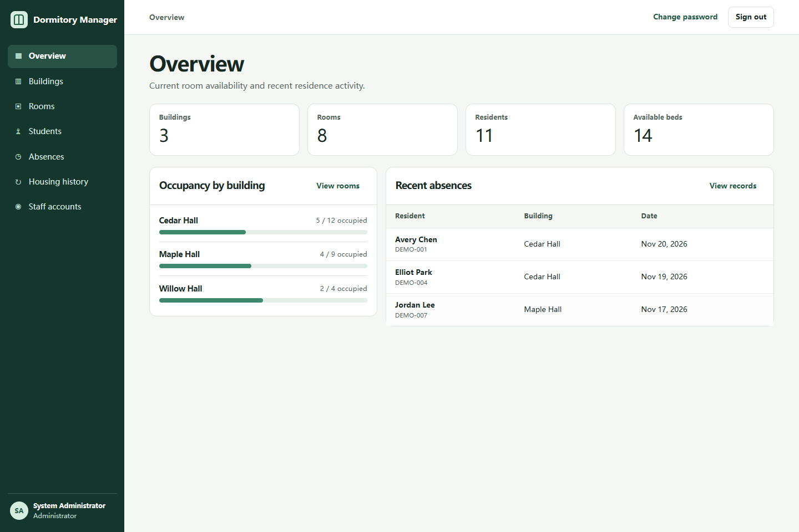
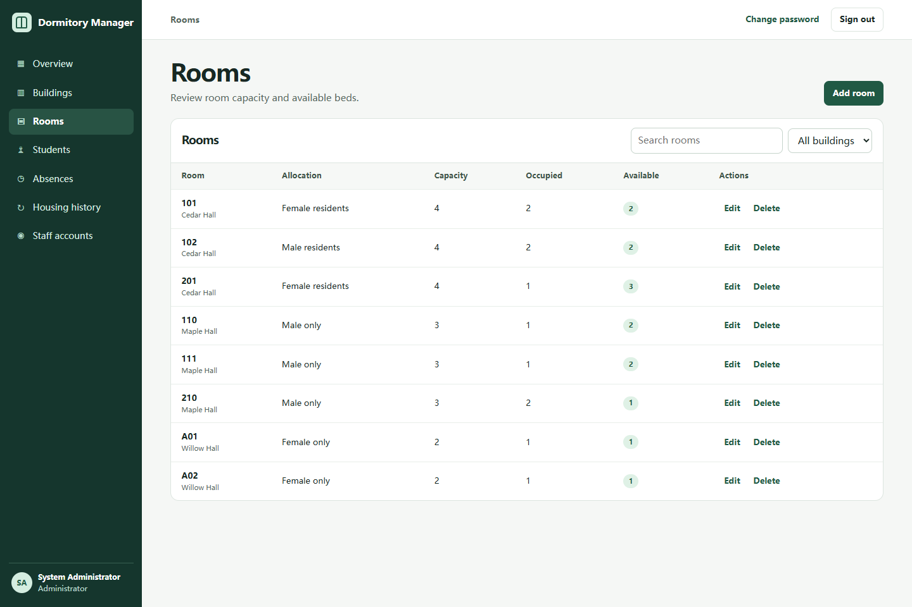
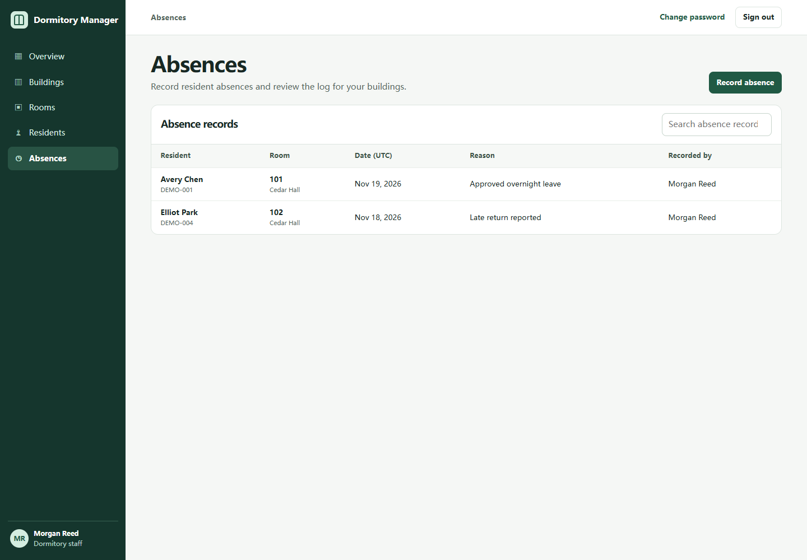
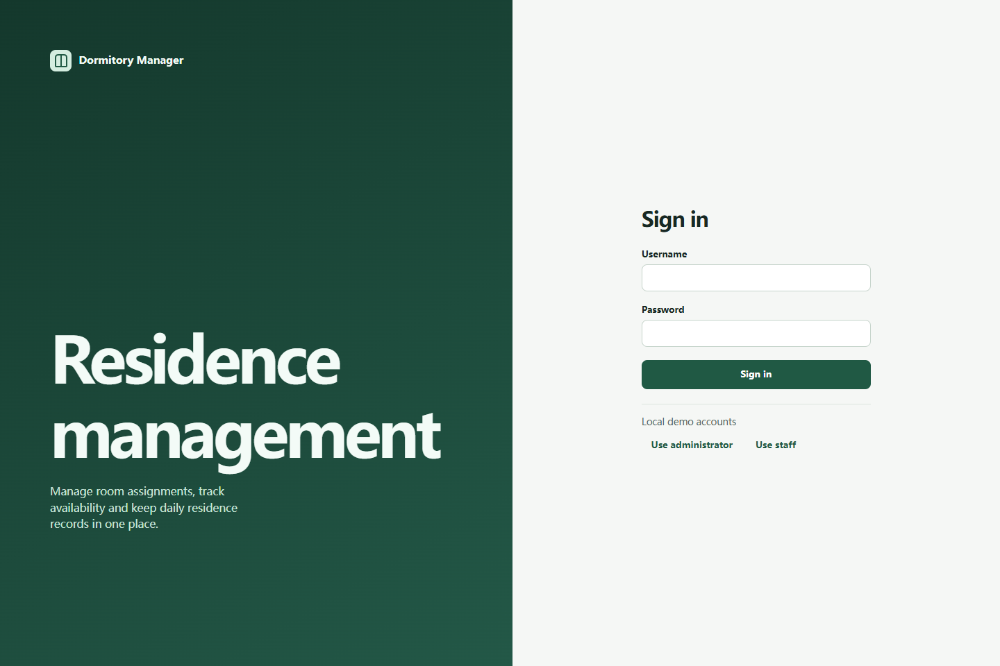

# Dormitory Management System

English · [简体中文](README.zh-CN.md)

[](https://github.com/cpg25ncu/dormitory-management-system/actions/workflows/ci.yml)
[](https://github.com/cpg25ncu/dormitory-management-system/actions/workflows/codeql.yml)
[](https://github.com/cpg25ncu/dormitory-management-system/releases/latest)
[](LICENSE)

Dormitory Manager is a web application for university residence operations. Administrators manage buildings, rooms, students and staff accounts, and check students in, transfer them between rooms and check them out. Dormitory staff record and correct absences for the buildings assigned to them.

**[Open the browser demo](https://cpg25ncu.github.io/dormitory-management-system/)** · **[Browse the API reference](https://cpg25ncu.github.io/dormitory-management-system/api/)** · [Changelog](CHANGELOG.md)



## Quick start

**In the browser.** The [browser demo](https://cpg25ncu.github.io/dormitory-management-system/) runs entirely in your tab with fictional records. Choose **Use administrator** to check Taylor Nguyen into a room. Only rooms that fit her are offered. Then sign in as staff to record or correct an absence. **Reset demo** restores the starting records.

**With Docker.** Run the full application with its demo profile and an in-memory database:

```bash
docker run --rm -p 127.0.0.1:8080:8080 ghcr.io/cpg25ncu/dormitory-management-system:1.1 \
  --spring.profiles.active=demo --server.address=0.0.0.0
```

Open <http://127.0.0.1:8080> and choose a demo account. The staff account manages Cedar Hall, a mixed hall. Maple Hall houses male students and Willow Hall female students.

**From source.** Use Java 17 or newer. The Maven Wrapper downloads Maven on its first run. On Windows, use `.\mvnw.cmd` in PowerShell.

```bash
sh ./mvnw -B clean verify
java -jar target/dormitory-management-system-1.1.0.jar --spring.profiles.active=demo
```

**For real records.** Docker Compose builds the application from source and runs it with MySQL 8.4. Copy `.env.example` to `.env`, set distinct `DORM_DB_PASSWORD` and `DORM_ADMIN_PASSWORD` values and the residence's `DORM_TIME_ZONE`, then start it:

```bash
cp .env.example .env
docker compose up --build -d --wait
```

Flyway creates the schema, and the first administrator is created from the configured credentials. [Deployment and operations](docs/deployment.md) covers configuration, reverse proxies, health checks, backups and upgrades.

## Features

| System administrator | Dormitory staff |
| --- | --- |
| Manage buildings, rooms, student records and staff accounts | View buildings, rooms and residents within their assignments |
| Set mixed, female-only or male-only building policies | See each room’s allocation and available beds |
| Check students in, transfer rooms and check students out | Record absences for residents of their buildings |
| Assign staff to buildings and manage account access | Correct or withdraw absence records, with the change recorded |
| Search, filter and export students, absences and housing history as CSV | Search, filter and export their buildings’ absence records |
| Review all absence records and housing history | Change their own password |

## Engineering highlights

- **Concurrent allocation without overbooking.** Check-ins, transfers, gender changes and policy changes lock rows in one order: student, rooms, then building. Two requests for the last bed, or a policy change racing a conflicting check-in, cannot both succeed, and the paths cannot deadlock. The policy race test fails if the building lock is removed. [Allocation rules](docs/architecture.md#allocation-rules) · [Rule tests](src/test/java/io/github/cpg25ncu/dormitory/AllocationRulesTest.java)
- **Consistent history.** A transfer closes one stay and opens the next in a single transaction. A failed transfer leaves the original assignment untouched. Absence corrections and withdrawals keep who changed what and when. [Transaction design](docs/architecture.md#check-in-transfers-and-checkout)
- **Correct local dates.** Timestamps are stored in UTC, while calendar days follow the residence's time zone, so staff can record today's absences right after local midnight. Tests pin the application clock to the hours when the dates differ, and the browser suite runs the server at UTC+14. [Dates and time zones](docs/deployment.md#dates-and-time-zones)
- **Lists that scale, exports that are safe.** Students, absences and housing history are paged, searched and filtered in parameterized SQL backed by indexes. CSV exports read a consistent snapshot in batches and neutralize cells that a spreadsheet would run as formulas. [Lists and exports](docs/architecture.md#lists-and-exports)
- **Defence in depth.** Session sign-in with CSRF protection, BCrypt and per-building scope checks in SQL. Credential changes end existing sessions, and repeated failed sign-ins are throttled per username and address. A strict Content Security Policy is in place, and CodeQL, Dependabot and secret scanning guard the repository. [Request boundaries](docs/architecture.md#request-boundaries) · [Security policy](SECURITY.md)
- **Verified at every level.** The integration suite runs on H2 and, through Testcontainers, on MySQL 8.4. A coverage gate (90% of lines, 70% of branches) and an OpenAPI contract test guard the build. Playwright drives the packaged application, and CI deploys the Compose stack and runs a smoke test against it. [Testing and CI](docs/testing.md)
- **Ready to operate.** The multi-stage image runs as an unprivileged user and has health and readiness probes. Releases publish the image, the JAR and checksums automatically. [Deployment and operations](docs/deployment.md)

## Technology

| Area | Choices |
| --- | --- |
| Backend | Java 17, Spring Boot 4.1, Spring MVC, Spring Security, Spring JDBC (`JdbcClient`), Bean Validation |
| Data | MySQL 8.4 with Flyway migrations; H2 for the demo profile and default test runs |
| Frontend | HTML, CSS and native JavaScript modules, served from the same JAR as the API, with no framework or build step |
| Testing | JUnit 5, MockMvc, Testcontainers, Playwright, JaCoCo |
| Delivery | Docker, Docker Compose, GitHub Actions, GitHub Container Registry, GitHub Pages |

## Screenshots

Captured from the packaged application with fictional demo records by `npm run screenshots` in `frontend/`. Select an image for the full-size view.

| Student records | Room allocation |
| --- | --- |
| [](docs/media/student-housing.png) | [](docs/media/room-allocation.png) |
| **Absence corrections (staff)** | **Sign-in** |
| [](docs/media/staff-absences.png) | [](docs/media/sign-in.png) |

## Project structure

| Path | Purpose |
| --- | --- |
| [src/main/java/](src/main/java/) | Spring Boot API, security and business rules, by area: `account`, `security`, `directory`, `housing`, `attendance` |
| [src/main/resources/](src/main/resources/) | Configuration and versioned Flyway migrations |
| [src/test/](src/test/) | HTTP integration tests, the OpenAPI contract test and unit tests |
| [frontend/src/](frontend/src/) | HTML, CSS and JavaScript modules for both workspaces |
| [frontend/tests/](frontend/tests/), [frontend/screenshots/](frontend/screenshots/) | Browser tests and the README screenshot capture |
| [frontend/demo/](frontend/demo/) | Browser-only backend and build for the Pages demo and API reference |
| [docs/](docs/) | Architecture, deployment and testing guides, and the OpenAPI contract |
| [scripts/](scripts/) | Deployment smoke test, coverage summary and release notes |
| [Dockerfile](Dockerfile), [compose.yaml](compose.yaml) | Container image and the application with MySQL |
| [.github/](.github/) | CI, CodeQL, release and Pages workflows, Dependabot and contribution templates |

## Documentation

- [Architecture and roles](docs/architecture.md)
- [API reference](https://cpg25ncu.github.io/dormitory-management-system/api/), rendered from the [OpenAPI contract](docs/openapi.yaml)
- [Deployment and operations](docs/deployment.md)
- [Development and testing](docs/testing.md)
- [Changelog](CHANGELOG.md)
- [Contribution guide](.github/CONTRIBUTING.md) and [security policy](SECURITY.md)

## License

This project is licensed under the [MIT License](LICENSE).
