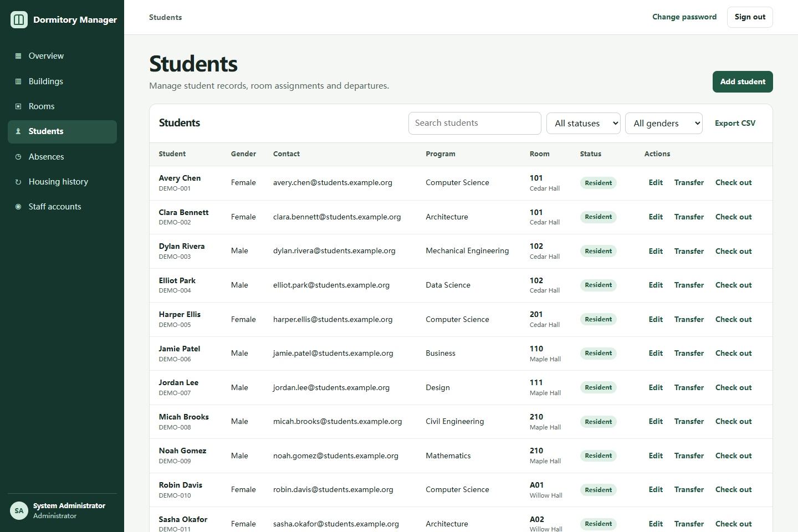
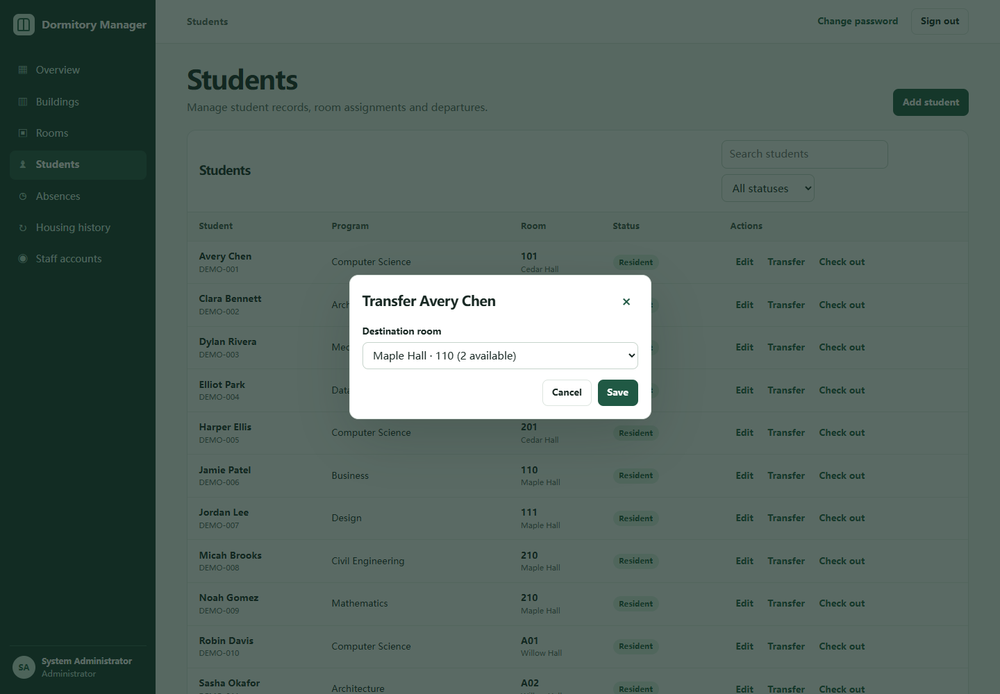

# Dormitory Management System

[](https://github.com/cpg25ncu/dormitory-management-system/actions/workflows/ci.yml)

Dormitory Manager is a web application for university residence operations. It manages buildings, room capacity, student assignments and absence records through separate administrator and staff workspaces.

## Live Demo

[Open the interactive browser demo](https://cpg25ncu.github.io/dormitory-management-system/) · [Browse the API reference](https://cpg25ncu.github.io/dormitory-management-system/api/)

Choose **Use administrator** to check Taylor Nguyen into Cedar Hall. Sign out and choose **Use staff** to record an absence, then switch back to the administrator to transfer the student or check them out. The demo uses fictional records and stores changes in your browser tab. **Reset demo** restores the starting records.


## Features

| System administrator | Dormitory staff |
| --- | --- |
| Manage buildings, rooms, student records and staff accounts | View buildings, rooms and residents within their assignments |
| Set mixed, female-only or male-only building policies | See each room’s allocation and available beds |
| Assign staff to buildings and manage account access | Record resident absences and review their buildings’ absence history |
| Check students in, transfer rooms and check students out | Review live room occupancy and availability |
| Review all absence records and housing history | Correct or withdraw absence records, with the change recorded |
| Correct or withdraw any absence record | Search, filter and export their buildings’ absence records |
| Search, filter and export students and housing history as CSV | Change their own password |

## Engineering Highlights

- **Concurrent bed allocation.** Check-in locks the student and room rows with `SELECT … FOR UPDATE` and counts active stays inside the transaction. When two requests compete for the last bed, the integration test verifies one succeeds and the other returns HTTP 409. [Housing service](src/main/java/io/github/cpg25ncu/dormitory/housing/Housing.java) · [Integration tests](src/test/java/io/github/cpg25ncu/dormitory/ResidenceWorkflowsTest.java)
- **Allocation rules.** Building gender policies, single-gender rooms and a required recorded gender apply to every check-in and transfer. The reverse checks apply to policy and gender edits. All of these operations lock rows in one order: student, rooms, building. A concurrency test shows a policy change and a conflicting check-in cannot both succeed. [Allocation rules](docs/architecture.md#allocation-rules) · [Rule tests](src/test/java/io/github/cpg25ncu/dormitory/AllocationRulesTest.java)
- **Transaction consistency.** Transfers acquire room locks in ascending order, close the existing stay, and open the destination stay in one transaction. Tests verify a failed transfer preserves the original assignment and a checkout releases its bed while keeping the recorded history. [Transaction design](docs/architecture.md#check-in-transfers-and-checkout)
- **Residence time zone.** Timestamps are stored in UTC, while calendar days follow the configured residence time zone. Staff can record today's absences right after local midnight, before the UTC date changes. Tests pin the application clock to those hours, and the browser suite runs the server at UTC+14. [Dates and time zones](docs/deployment.md#dates-and-time-zones) · [Time tests](src/test/java/io/github/cpg25ncu/dormitory/ResidenceTimeTest.java)
- **Server-side lists and safe exports.** Students, absences and housing history are paged, searched and filtered in parameterized SQL, and wildcard characters match literally. CSV exports read a consistent snapshot in batches, so memory use stays bounded. Exports are UTF-8 with a byte order mark for spreadsheet applications, and cells that would run as formulas are neutralized. [Lists and exports](docs/architecture.md#lists-and-exports) · [Export tests](src/test/java/io/github/cpg25ncu/dormitory/PagingAndExportTest.java)
- **Role-based access control.** Spring Security reserves administration endpoints for administrators. Database queries restrict staff to assigned buildings, including which residents they can record absences for. Disabling an account or changing its credentials invalidates its existing sessions. Repeated failed sign-ins lock a username for the client's address. [Access rules](docs/architecture.md#request-boundaries)
- **Deployable from source.** A multi-stage Dockerfile builds the layered Spring Boot image and runs it as an unprivileged user. Public health and readiness probes back the container health check. A smoke-test script verifies a running deployment. [Deployment and operations](docs/deployment.md)
- **Automated verification.** GitHub Actions runs the backend suite against H2 and, through Testcontainers, MySQL 8.4. The build fails if line coverage drops below 90% or branch coverage below 70%, or if the OpenAPI contract and the implemented endpoints differ. Playwright exercises the packaged Spring Boot application, including rejected check-ins and transfers, staff building scope, and form error messages. CI then builds the Compose deployment from source and runs a housing workflow against MySQL. [Testing and CI](docs/testing.md)

## Screenshots

Captured from the Spring Boot application with fictional demo records. Select an image for the full-size view.

| Sign-in page | Student housing and check-in |
| --- | --- |
| [](docs/media/sign-in.png) | [](docs/media/student-housing.png) |
| **Room transfer** | **Staff absence log** |
| [](docs/media/room-transfer.png) | [](docs/media/staff-absences.png) |

## Try the local demo

Use Java 17 or newer. The Maven Wrapper downloads the project's Maven version on its first run.

```bash
sh ./mvnw -B clean verify
java -jar target/dormitory-management-system-1.0.0.jar --spring.profiles.active=demo
```

On Windows, run `.\mvnw.cmd -B clean verify` in PowerShell in place of the first command.

Open [Dormitory Manager on localhost](http://127.0.0.1:8080). The sign-in page offers two prefilled demo accounts. Their usernames are `admin` and `staff`. The staff workspace is assigned to Cedar Hall, a mixed hall. Maple Hall houses male students and Willow Hall female students. Demo data is fictional and lives in an in-memory database for the duration of the process.

Try adding a student as an administrator, assigning a Cedar Hall room, then recording an absence for that resident as staff. Sign back in as the administrator to transfer or check out the student and check the occupancy and history views.

## Run with persistent storage

Docker Compose builds the application from source and runs it with MySQL 8.4, so no local JDK is needed. Copy `.env.example` to `.env`, set distinct values for `DORM_DB_PASSWORD` and `DORM_ADMIN_PASSWORD`, and set `DORM_TIME_ZONE` to the residence's time zone.

```bash
cp .env.example .env
docker compose up --build -d --wait
```

Sign in at [http://127.0.0.1:8080](http://127.0.0.1:8080) with the configured administrator username and password. Flyway applies the schema at startup. The MySQL volume persists data between restarts, and the bootstrap password is used when creating the first administrator. See [Deployment and operations](docs/deployment.md) for configuration and backups.

## Project structure

| Path | Purpose |
| --- | --- |
| [frontend/src/](frontend/src/) | HTML, CSS and native JavaScript modules for both workspaces |
| [frontend/tests/](frontend/tests/) | Browser tests against the packaged application |
| [src/main/java/](src/main/java/) | Spring Boot API, Spring Security and business logic |
| [src/main/resources/](src/main/resources/) | Spring profiles and versioned Flyway migrations |
| [src/test/](src/test/) | Spring MVC and database integration tests |
| [Dockerfile](Dockerfile), [compose.yaml](compose.yaml) | Container image built from source, and the application and MySQL deployment |
| [scripts/](scripts/) | Deployment smoke test |
| [.github/workflows/](.github/workflows/) | Build, MySQL, browser and Compose checks, and the demo deployment |

Maven packages the frontend with Spring Boot in one JAR. The browser loads the UI and API on the same origin. Node.js supports the Playwright test suite and the [standalone browser demo build](docs/testing.md#standalone-browser-demo).

## Development and contributors

- [Architecture and roles](docs/architecture.md)
- [API reference](https://cpg25ncu.github.io/dormitory-management-system/api/) rendered from the [OpenAPI contract](docs/openapi.yaml)
- [Testing and CI](docs/testing.md)
- [Deployment and backups](docs/deployment.md)
- [Contribution guide](.github/CONTRIBUTING.md)
- [Security policy](SECURITY.md)

## License

This project is licensed under the [MIT License](LICENSE).
