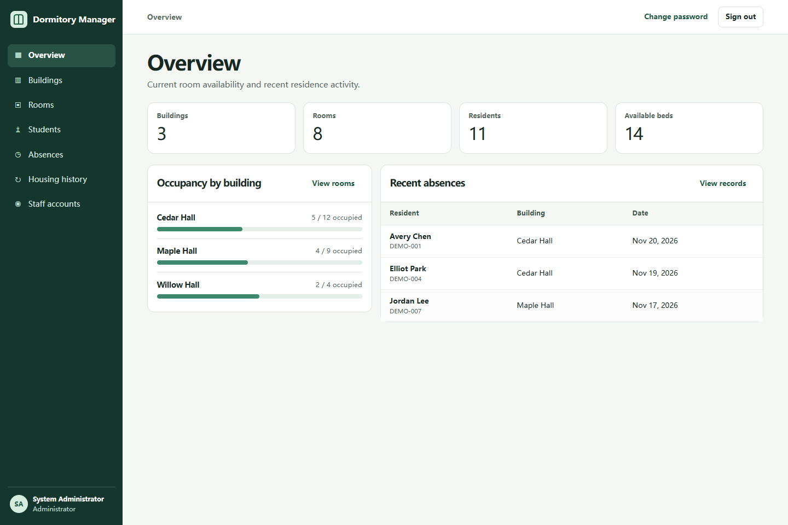
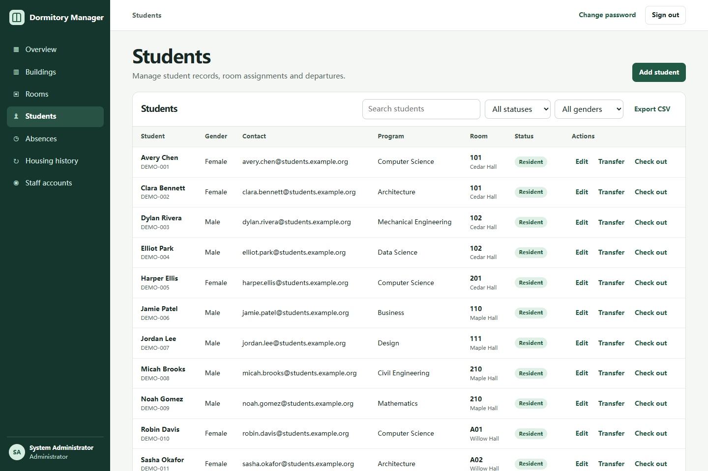
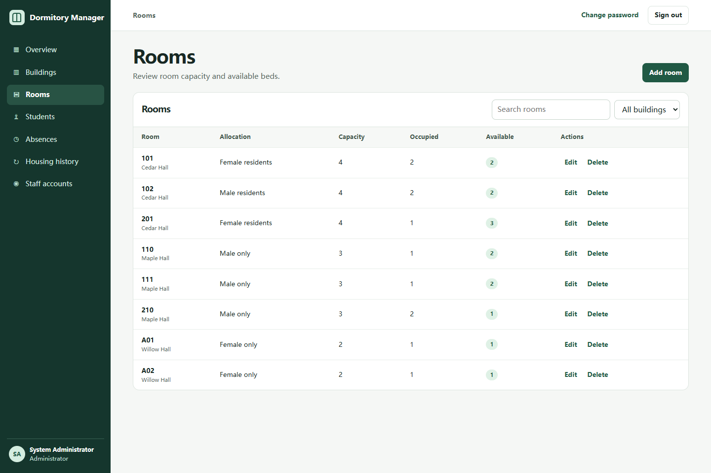
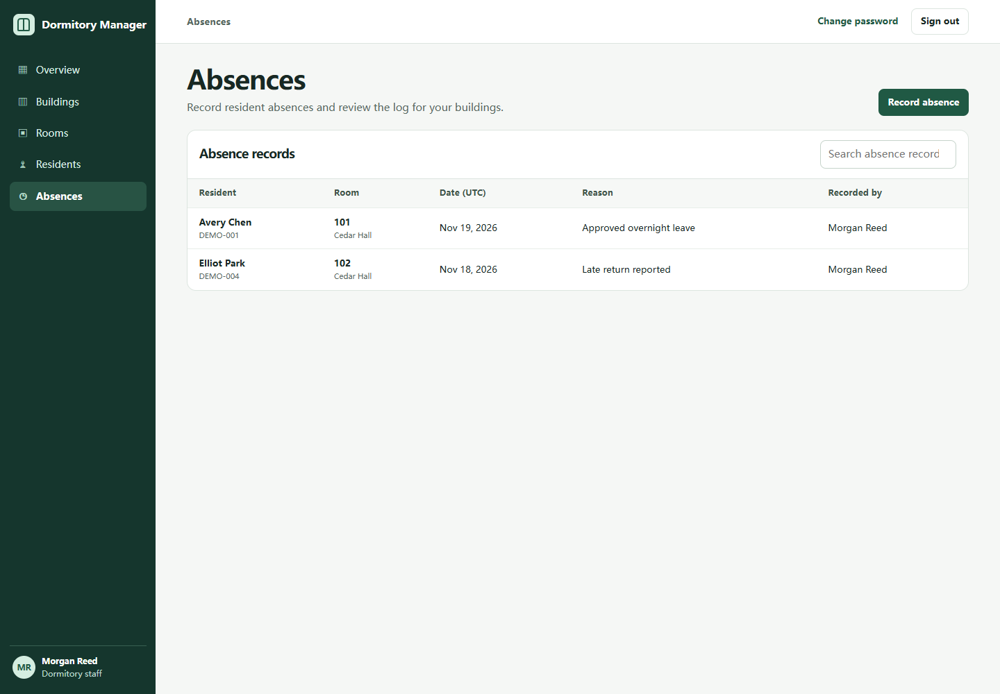
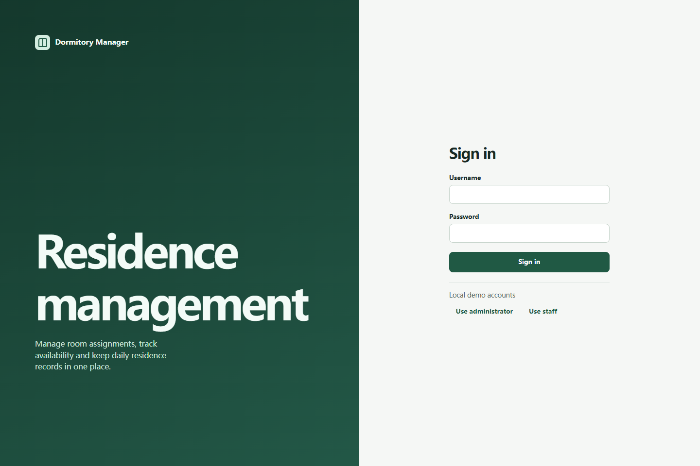

# 宿舍管理系统

[English](README.md) · 简体中文

[](https://github.com/cpg25ncu/dormitory-management-system/actions/workflows/ci.yml)
[](https://github.com/cpg25ncu/dormitory-management-system/actions/workflows/codeql.yml)
[](https://github.com/cpg25ncu/dormitory-management-system/releases/latest)
[](LICENSE)

宿舍管理系统（Dormitory Manager）是一个面向高校住宿管理的 Web 应用：

- **系统管理员**：管理楼栋、房间、学生和宿管账号，办理入住、调宿和退宿。
- **宿管**：登记和更正自己所负责楼栋的学生缺勤。

**[打开浏览器演示](https://cpg25ncu.github.io/dormitory-management-system/)** · **[查看 API 文档](https://cpg25ncu.github.io/dormitory-management-system/api/)** · [更新日志](CHANGELOG.md)



## 快速开始

### 在浏览器里试用

[浏览器演示](https://cpg25ncu.github.io/dormitory-management-system/)完全在你的浏览器标签页中运行，使用的都是虚构数据。

1. 选择 **Use administrator**，为 Taylor Nguyen 办理入住，系统只会列出适合她的房间。
2. 改用宿管身份登录，登记或更正一条缺勤。

点击 **Reset demo** 可以恢复初始数据。

### 用 Docker 运行

以演示配置和内存数据库运行完整应用：

```bash
docker run --rm -p 127.0.0.1:8080:8080 ghcr.io/cpg25ncu/dormitory-management-system:1.1 \
  --spring.profiles.active=demo --server.address=0.0.0.0
```

打开 <http://127.0.0.1:8080>，选择一个演示账号。演示数据包含三栋楼：

- Cedar Hall：混住楼，由演示宿管账号负责
- Maple Hall：男生楼
- Willow Hall：女生楼

### 从源码运行

需要 Java 17 或更高版本。首次运行时，Maven Wrapper 会自动下载 Maven。在 Windows 的 PowerShell 中请使用 `.\mvnw.cmd`。

```bash
sh ./mvnw -B clean verify
java -jar target/dormitory-management-system-1.1.0.jar --spring.profiles.active=demo
```

### 部署到正式环境

Docker Compose 会从源码构建应用，并与 MySQL 8.4 一起运行。

1. 把 `.env.example` 复制为 `.env`。
2. 为 `DORM_DB_PASSWORD` 和 `DORM_ADMIN_PASSWORD` 设置两个不同的密码，并把 `DORM_TIME_ZONE` 设为学校所在的时区。
3. 启动服务：

```bash
cp .env.example .env
docker compose up --build -d --wait
```

启动时，Flyway 会建好数据库表结构，并按配置的账号密码创建第一个管理员。配置项、反向代理、健康检查、备份和升级的说明见[部署与运维](docs/deployment.md)（英文）。

## 功能

| 系统管理员 | 宿管 |
| --- | --- |
| 管理楼栋、房间、学生档案和宿管账号 | 查看自己负责楼栋的房间和住户 |
| 设置楼栋性别政策：混住、仅女生、仅男生 | 查看每个房间的分配情况和空床位 |
| 办理入住、调宿和退宿 | 为所负责楼栋的住户登记缺勤 |
| 为楼栋指定宿管，管理账号权限 | 更正或撤销缺勤记录，系统会记下修改人和时间 |
| 搜索、筛选学生、缺勤和住宿历史，并导出为 CSV | 搜索、筛选并导出所负责楼栋的缺勤记录 |
| 查看全部缺勤记录和住宿历史 | 修改自己的密码 |

## 工程亮点

- **并发分配不会超订。**
  - 入住、调宿、修改学生性别、修改楼栋政策，都按固定顺序加锁：先学生，再房间，最后楼栋。
  - 两个请求同时抢最后一个床位，或者修改楼栋政策的同时有人办理冲突的入住，都不可能双双成功；固定的加锁顺序也保证不会死锁。
  - 如果去掉楼栋锁，对应的并发测试会失败。
  - 详见[分配规则](docs/architecture.md#allocation-rules) · [规则测试](src/test/java/io/github/cpg25ncu/dormitory/AllocationRulesTest.java)
- **历史记录保持一致。**
  - 调宿在同一个事务里关闭旧住宿、开启新住宿；调宿失败时，原来的住宿保持不变。
  - 缺勤的更正和撤销会记下由谁、在什么时间、做了什么修改。
  - 详见[事务设计](docs/architecture.md#check-in-transfers-and-checkout)
- **本地日期正确。**
  - 时间戳统一按 UTC 存储；"哪一天"则按学校所在时区计算，所以过了当地午夜，就能立即登记当天的缺勤。
  - 测试会把应用时钟固定在本地日期和 UTC 日期不一致的时段；浏览器测试让服务器运行在 UTC+14 时区。
  - 详见[日期与时区](docs/deployment.md#dates-and-time-zones)
- **列表可扩展，导出更安全。**
  - 学生、缺勤、住宿历史都在服务端分页、搜索和筛选：SQL 全部参数化，排序字段有索引支持。
  - CSV 导出时分批读取同一时刻的数据快照；可能被表格软件当作公式执行的单元格会被转义。
  - 详见[列表与导出](docs/architecture.md#lists-and-exports)
- **多层安全防护。**
  - 应用层：基于会话的登录，CSRF 防护，BCrypt 密码哈希，在 SQL 层校验楼栋权限；修改密码或停用账号会让现有会话立即失效；登录失败次数按"用户名 + IP"限流；启用了严格的内容安全策略（CSP）。
  - 仓库层：CodeQL、Dependabot 和密钥扫描。
  - 详见[请求边界](docs/architecture.md#request-boundaries) · [安全政策](SECURITY.md)
- **各层都有验证。**
  - 集成测试既在 H2 上跑，也通过 Testcontainers 在 MySQL 8.4 上跑。
  - 覆盖率门槛（行覆盖 90%、分支覆盖 70%）和 OpenAPI 契约测试守住构建。
  - Playwright 驱动打包好的应用做浏览器测试；CI 会部署整套 Compose 环境，并运行冒烟测试。
  - 详见[测试与 CI](docs/testing.md)
- **可直接运维。**
  - 多阶段构建的镜像以非 root 用户运行，带健康检查和就绪探针。
  - 发版时自动发布镜像、JAR 包和校验和。
  - 详见[部署与运维](docs/deployment.md)

## 技术栈

| 领域 | 选型 |
| --- | --- |
| 后端 | Java 17、Spring Boot 4.1、Spring MVC、Spring Security、Spring JDBC（`JdbcClient`）、Bean Validation |
| 数据 | MySQL 8.4 + Flyway 数据库迁移；演示配置和默认测试使用 H2 |
| 前端 | HTML、CSS 和原生 JavaScript 模块，与 API 打包在同一个 JAR 中，不依赖框架，也不需要构建步骤 |
| 测试 | JUnit 5、MockMvc、Testcontainers、Playwright、JaCoCo |
| 交付 | Docker、Docker Compose、GitHub Actions、GitHub Container Registry、GitHub Pages |

## 截图

截图由 `frontend/` 下的 `npm run screenshots` 命令自动生成：启动打包好的应用，使用虚构的演示数据截取。点击图片可查看大图。

| 学生档案 | 房间分配 |
| --- | --- |
| [](docs/media/student-housing.png) | [](docs/media/room-allocation.png) |
| **缺勤更正（宿管）** | **登录页** |
| [](docs/media/staff-absences.png) | [](docs/media/sign-in.png) |

## 项目结构

| 路径 | 用途 |
| --- | --- |
| [src/main/java/](src/main/java/) | Spring Boot API、安全和业务规则，按领域分包：`account`、`security`、`directory`、`housing`、`attendance` |
| [src/main/resources/](src/main/resources/) | 配置文件和带版本号的 Flyway 迁移脚本 |
| [src/test/](src/test/) | HTTP 集成测试、OpenAPI 契约测试和单元测试 |
| [frontend/src/](frontend/src/) | 两种角色工作台共用的 HTML、CSS 和 JavaScript 模块 |
| [frontend/tests/](frontend/tests/)、[frontend/screenshots/](frontend/screenshots/) | 浏览器测试和 README 截图脚本 |
| [frontend/demo/](frontend/demo/) | Pages 演示使用的浏览器端模拟后端，以及演示和 API 文档的构建脚本 |
| [docs/](docs/) | 架构、部署、测试文档和 OpenAPI 契约 |
| [scripts/](scripts/) | 部署冒烟测试、覆盖率汇总和发布说明脚本 |
| [Dockerfile](Dockerfile)、[compose.yaml](compose.yaml) | 容器镜像，以及应用与 MySQL 的编排配置 |
| [.github/](.github/) | CI、CodeQL、发布和 Pages 工作流，Dependabot 配置和协作模板 |

## 文档

详细文档目前为英文：

- [架构与角色](docs/architecture.md)
- [API 文档](https://cpg25ncu.github.io/dormitory-management-system/api/)，由 [OpenAPI 契约](docs/openapi.yaml)生成
- [部署与运维](docs/deployment.md)
- [开发与测试](docs/testing.md)
- [更新日志](CHANGELOG.md)
- [贡献指南](.github/CONTRIBUTING.md)和[安全政策](SECURITY.md)

## 许可证

本项目以 [MIT 许可证](LICENSE)发布。
