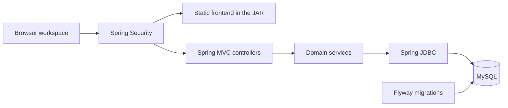
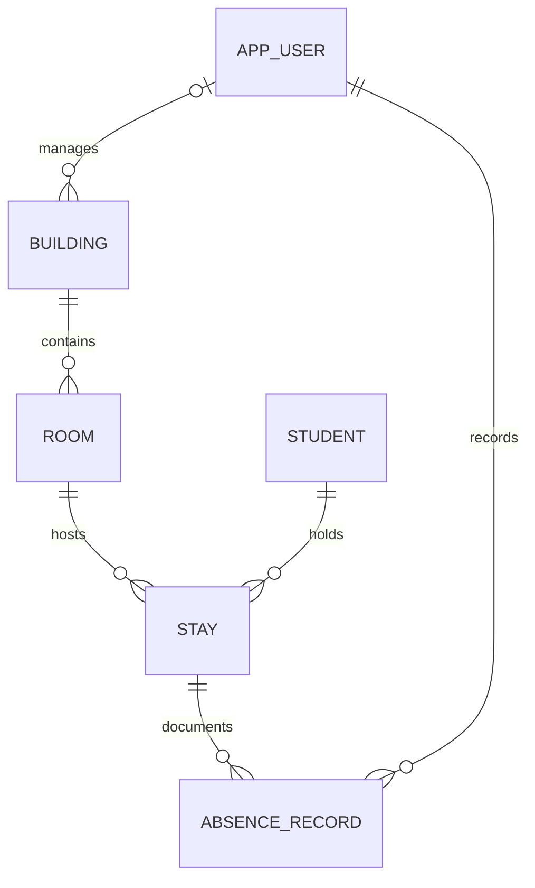

# Architecture

The source in [frontend/src](../frontend/src/) uses HTML, CSS and native JavaScript modules. Maven copies the frontend into the Spring Boot JAR as static assets. Spring Boot serves them on the same origin as the API, so the application can use session cookies and CSRF protection across both workspaces.

Spring MVC validates input and returns JSON. Domain services own business rules and use Spring JDBC for parameterized database access. Flyway applies the SQL migrations.

| Area | Responsibilities |
| --- | --- |
| `account`, `security` | Sessions, credentials, staff administration and role checks |
| `directory` | Buildings, building managers and student records |
| `housing` | Rooms, capacity, assignments and housing history |
| `attendance` | Building-scoped absence records |
| `bootstrap`, `common` | Initial administrator, demo fixtures and API error responses |

## Data model

- A building can have one assigned staff account. A staff account can manage multiple buildings.
- A building has a gender policy: mixed, female only or male only. A student has a gender, optional contact details and a program. Records created before genders were recorded keep a NULL gender until an administrator records it.
- A stay records the student, room, opening operator and start time. Closed stays also record the departure type, reason, time and closing operator.
- The database uses a nullable unique active-student reference to enforce one open stay per student. Vacancy is derived from room capacity less the count of open stays.
- Absences reference the stay for the relevant building and room. The unique stay/date pair prevents duplicate entries. The operator and operational date are recorded.
- An absence record can be corrected or withdrawn by anyone who can see its building. A correction keeps the stay and records who made it and when. Its date must fall within the stay, so a record for a resident who has since moved can still be corrected. A withdrawal records who withdrew the record, when and why, and keeps the record for review. Recording the same resident and day again restores the withdrawn record. Every absence write locks the stay row first, so writes for one stay run one at a time and none can race a checkout of that stay.
- Stay timestamps come from the application clock and are stored in UTC. Absence dates are calendar days in the residence's configured time zone, and an absence must fall on or after the local day of the check-in. `ResidenceTime` holds these rules, and tests replace its clock to check the hours when the local and UTC dates differ.
- Referential integrity protects housing and absence history. A student or room linked to a stay cannot be physically deleted through the API.

## Check-in, transfers and checkout

Housing writes lock the student row first. Changes that affect capacity also lock the applicable room rows, using ascending room IDs when a transfer involves two rooms. The service checks availability inside the transaction. A transfer closes the existing stay and opens the destination stay before committing. A room-capacity edit uses the same room lock and rejects capacity below current occupancy.

The workflow tests exercise simultaneous check-ins for a single remaining bed and verify a failed transfer preserves the current assignment.

## Allocation rules

A check-in or transfer needs a recorded gender, a building whose policy houses that gender, and a room whose current residents share it. Every room is single-gender, including rooms in mixed buildings. Residents whose gender is not recorded count as a mismatch, so legacy records cannot hide a conflict. The same rules apply in reverse. A building cannot switch to a single-gender policy while a resident does not match it, and a resident's gender cannot change to one that does not fit their building or roommates.

[`AllocationRules`](../src/main/java/io/github/cpg25ncu/dormitory/housing/AllocationRules.java) holds these checks and fixes the lock order for every operation that reads or changes them: student, then rooms by ascending ID, then building. A policy change locks only the building, and a gender change locks the student and then the student's current room and building. Whichever of two concurrent operations locks the building first commits first, and the other sees its result. Because every path acquires locks in the same order, they cannot deadlock. A test runs policy changes and check-ins concurrently and verifies that exactly one of each pair succeeds. Without the building lock, the test fails.

| Rule | Rejected request | Response |
| --- | --- | --- |
| Gender recorded | Check-in or transfer of a student without a recorded gender | 409 |
| Building policy | Assignment to a building whose policy excludes the student | 409 |
| Single-gender rooms | Assignment to a room with residents not recorded as the student's gender | 409 |
| Policy change | A single-gender policy while a resident is not recorded as that gender | 409 |
| Gender change | A gender that does not fit the resident's building or roommates | 409 |

## Request boundaries

| API | Scope |
| --- | --- |
| `GET /api/session`, `POST /api/login`, `POST /api/logout` | Session and sign-in lifecycle |
| `PUT /api/password` | Current user |
| `GET /api/buildings`, `GET /api/rooms`, `GET /api/residents` | Administrators or the staff account’s assigned buildings |
| `GET /api/absences`, `POST /api/absences`, `PUT /api/absences/{id}`, `POST /api/absences/{id}/withdraw` | Administrators or the staff account’s assigned buildings |
| `/api/admin/**` | Administrators only |

Spring Security manages session cookies and CSRF protection. The browser retrieves the CSRF token from the session endpoint and supplies it with state-changing requests. Passwords use BCrypt. Disabling an account or changing its password increments its credential version, invalidating sessions issued under the old version. The API never returns password hashes.

The [OpenAPI contract](openapi.yaml) specifies methods, paths, request bodies and response schemas. A client first reads `GET /api/session`, keeps its session cookie and sends the returned header and token with `POST /api/login`. After a successful login, it reads the session again before submitting writes. A successful password change ends the session.
