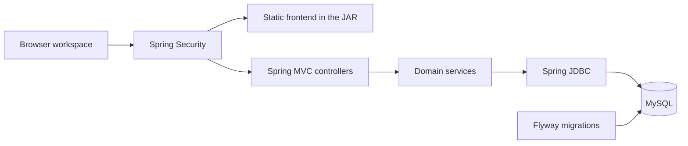
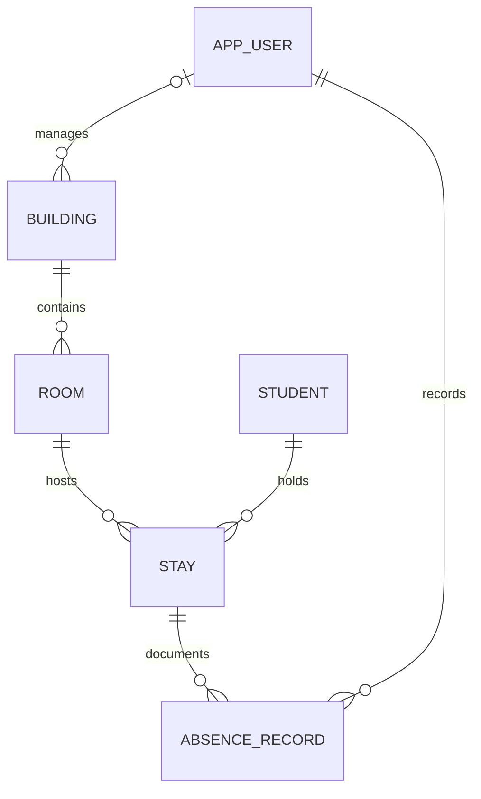

# Architecture

The source in [frontend/src](../frontend/src/) uses HTML, CSS and native JavaScript modules. Maven copies the frontend into the Spring Boot JAR as static assets. Spring Boot serves them on the same origin as the API, so the application can use session cookies and CSRF protection across both workspaces.

Spring MVC validates input and returns JSON. Domain services own business rules and use Spring JDBC for parameterized database access. Flyway applies the SQL migrations.

| Area | Responsibilities |
| --- | --- |
| `account`, `security` | Sessions, credentials, staff administration and role checks |
| `directory` | Buildings, building managers and student records |
| `housing` | Rooms, capacity, assignments and housing history |
| `attendance` | Building-scoped absence records |
| `bootstrap`, `common` | Initial administrator, demo fixtures and API error responses |

## Data model

- A building can have one assigned staff account. A staff account can manage multiple buildings.
- A stay records the student, room, opening operator and start time. Closed stays also record the departure type, reason, time and closing operator.
- The database uses a nullable unique active-student reference to enforce one open stay per student. Vacancy is derived from room capacity less the count of open stays.
- Absences reference the stay for the relevant building and room. The unique stay/date pair prevents duplicate entries. The operator and operational date are recorded.
- Referential integrity protects housing and absence history. A student or room linked to a stay cannot be physically deleted through the API.

## Check-in, transfers and checkout

Housing writes lock the student row first. Changes that affect capacity also lock the applicable room rows, using ascending room IDs when a transfer involves two rooms. The service checks availability inside the transaction. A transfer closes the existing stay and opens the destination stay before committing. A room-capacity edit uses the same room lock and rejects capacity below current occupancy.

The workflow tests exercise simultaneous check-ins for a single remaining bed and verify a failed transfer preserves the current assignment.

## Request boundaries

| API | Scope |
| --- | --- |
| `GET /api/session`, `POST /api/login`, `POST /api/logout` | Session and sign-in lifecycle |
| `PUT /api/password` | Current user |
| `GET /api/buildings`, `GET /api/rooms`, `GET /api/residents` | Administrators or the staff account’s assigned buildings |
| `GET /api/absences`, `POST /api/absences` | Administrators or the staff account’s assigned buildings |
| `/api/admin/**` | Administrators only |

Spring Security manages session cookies and CSRF protection. The browser retrieves the CSRF token from the session endpoint and supplies it with state-changing requests. Passwords use BCrypt. Disabling an account or changing its password increments its credential version, invalidating sessions issued under the old version. The API never returns password hashes.

The [OpenAPI contract](openapi.yaml) specifies methods, paths, request bodies and response schemas. A client first reads `GET /api/session`, keeps its session cookie and sends the returned header and token with `POST /api/login`. After a successful login, it reads the session again before submitting writes. A successful password change ends the session.
